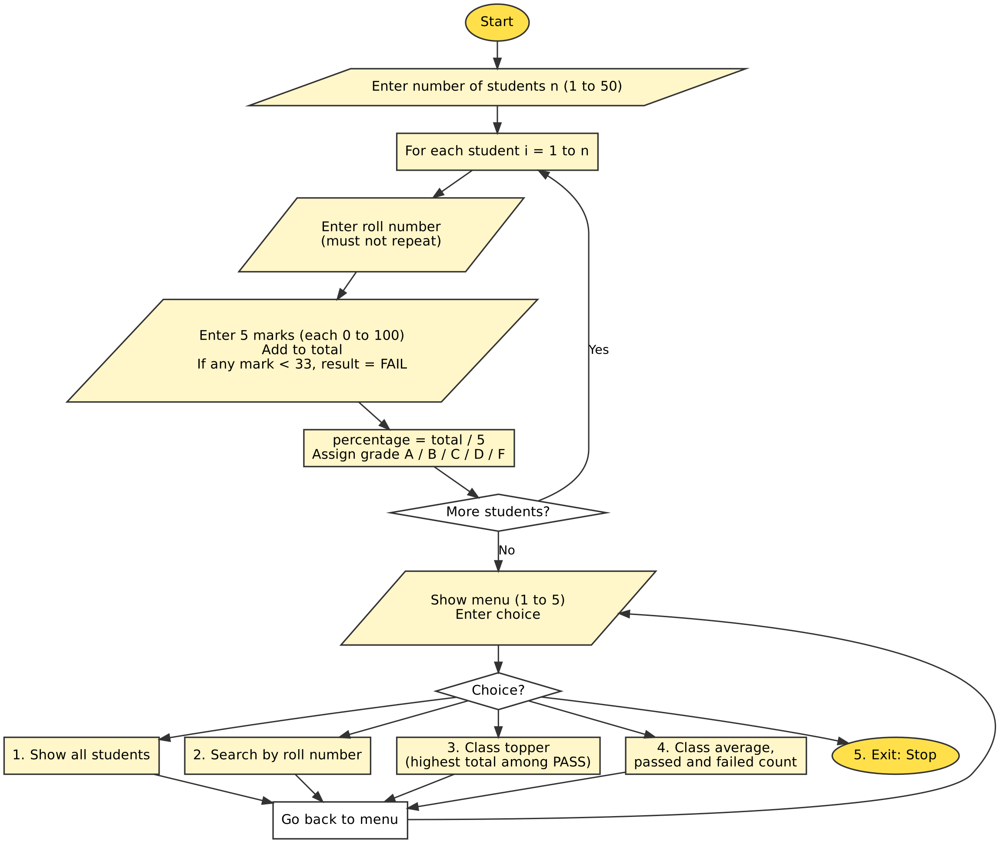

# Student Result and Grade Analyser

**Mini Hackathon | C Programming**  
**Team name:** CYBER SPARK | UPES, B.Tech Computer Science and Engineering  
**Batch:** 37 | **Team:** CYBER SPARK  
**Faculty:** Mr. Kshitij Kumre  

**Team members:** Parinay Prakash, Priyanshu Kumar, Mridul Gahotri

---

## 1. Problem Statement
Calculating the total, percentage, grade and pass/fail status of many students by hand is slow and can have mistakes. We need a program that takes the marks of many students and gives the result quickly and correctly, and also shows the class topper and class average.

## 2. Objectives
- Accept the marks of 5 subjects for multiple students
- Calculate total marks, percentage and grade automatically
- Decide PASS or FAIL using the minimum marks (33) in every subject
- Show the class topper and the class average
- Check the input (marks 0 to 100, no repeated roll number) so wrong data is not accepted

## 3. Features
- Takes data of up to **50 students** (roll number and marks of **5 subjects**)
- **Input checking:** marks must be between 0 and 100, and a roll number cannot be repeated
- Calculates **total** (out of 500), **percentage** and **grade**
- Shows **PASS or FAIL** (a student passes only if every subject has at least 33 marks)
- **Menu-driven:** show all students, search by roll number, class topper, class average, exit
- Class report: total students, passed, failed and class average

## 4. Rules Used
| Grade | Percentage |
|---|---|
| A | 80 and above |
| B | 70 to 79 |
| C | 60 to 69 |
| D | 50 to 59 |
| F | Below 50 |

- **Percentage** = total / 5 (total is out of 500)
- **Pass:** at least 33 marks in every subject
- **Topper:** the student with the highest total among the students who passed
- **Class average:** average of the percentages of all students

## 5. Algorithm
1. Start and ask the number of students (1 to 50).
2. For every student, take the roll number (it must not repeat) and the marks of 5 subjects (each between 0 and 100).
3. Add the marks to get the total and find the percentage.
4. Decide the grade from the percentage.
5. If every subject is 33 or more, the result is PASS, otherwise FAIL.
6. Show the menu: show all, search, topper, class average, exit.
7. Repeat the menu until the user chooses Exit.

### Flowchart


## 6. C Concepts Used
- Variables and data types (`int`, `float`, `char`)
- Arrays (`roll`, `total`, `percentage`, `grade`, `pass`)
- Loops (`for`, `while`)
- Decision making (`if-else`, `switch`)
- `printf` and `scanf`
- Input validation

## 7. How to Compile and Run
Needs a C compiler (gcc).

```
gcc student_result_analyser.c -o student_result_analyser
.\student_result_analyser
```
(On Linux or Mac use `./student_result_analyser`.)

## 8. Test Cases
Test data for 3 students (expected output and actual output from the program are the same):

| Roll | Marks (5 subjects) | Expected output | Actual output | Status |
|---|---|---|---|---|
| 1 | 80, 70, 90, 60, 65 | Total 365/500, 73.00%, Grade B, PASS | Total 365/500, 73.00%, Grade B, PASS | Pass |
| 2 | 30, 90, 95, 99, 100 | Total 414/500, 82.80%, Grade A, FAIL (30 is below 33) | Total 414/500, 82.80%, Grade A, FAIL | Pass |
| 3 | 50, 50, 50, 50, 50 | Total 250/500, 50.00%, Grade D, PASS | Total 250/500, 50.00%, Grade D, PASS | Pass |

Boundary, invalid and menu tests:

| Test | Input | Expected output | Actual output | Status |
|---|---|---|---|---|
| Repeated roll number | Roll 1 again for student 2 | "Roll number already used!" and asks again | "Roll number already used! Enter again:" | Pass |
| Wrong marks | 150 | "Wrong marks!" and asks again | "Wrong marks! Enter between 0 and 100:" | Pass |
| Search | Roll 2 | Roll 2 details (FAIL) | Roll 2, 414/500, 82.80, Grade A, FAIL | Pass |
| Topper | Option 3 | Roll 1, 365/500 | Topper: Roll 1, Total 365/500, Percentage 73.00 | Pass |
| Class average | Option 4 | 3 students, 2 passed, 1 failed, average 68.60 | Total 3, Passed 2, Failed 1, Class average 68.60 | Pass |
| Wrong menu choice | 9 | Error message | "Wrong choice! Enter 1 to 5." | Pass |

Screenshots of these runs are in the `screenshots` folder.

## 9. Sample Output
```
Roll: 1
Total: 365/500
Percentage: 73.00
Grade: B
Result: PASS

Roll: 2
Total: 414/500
Percentage: 82.80
Grade: A
Result: FAIL

Topper: Roll 1, Total 365/500, Percentage 73.00

Total students: 3
Passed: 2
Failed: 1
Class average: 68.60
```

## 10. Limitations and Future Scope
- Data is stored only while the program runs (in arrays), it is not saved in a file
- Student names are not stored
- Future: save and load records from a file, student names, subject-wise reports, grade charts

## 11. Files in this Repository
| File | What it is |
|---|---|
| `student_result_analyser.c` | Source code |
| `flowchart.png` | Flowchart of the program |
| `presentation.pptx` / `presentation.pdf` | Presentation |
| `screenshots/` | Output screenshots |
| `README.md` | This file |
